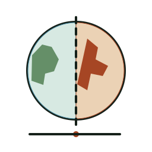
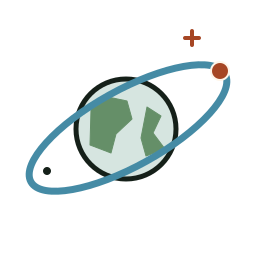
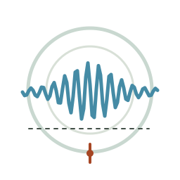
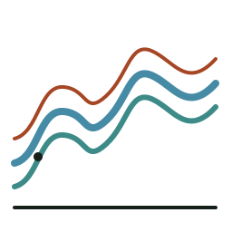
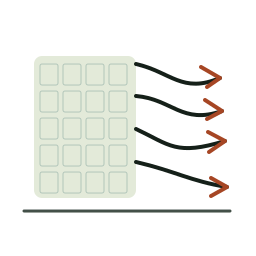
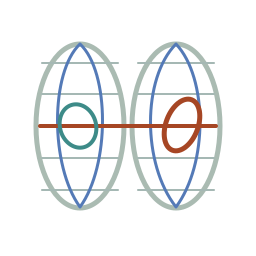
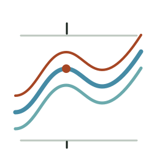
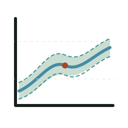
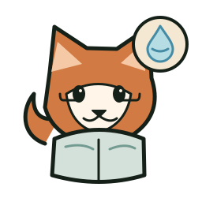
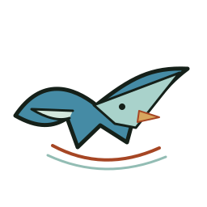

# GeoGeekLab — Visual Gallery

> **V0.2 concept review.** Artwork below is not an approved production release. Existing mascots remain canonical in their original project repositories.

## Scientific instrument identities — 8 proposals

Scientific instruments use geometry, scientific meaning and interface evidence rather than animal mascots.

| Instrument | Proposed symbol | Instrument | Proposed symbol |
|---|---|---|---|
| [Earth In Change](https://github.com/GeoGeekLab/earth-in-change) |  | [Orbital Commons](https://github.com/GeoGeekLab/orbital-commons) |  |
| [Earth Pulse](https://github.com/GeoGeekLab/earth-pulse) |  | [Geographic Flow Lab](https://github.com/GeoGeekLab/geographic-flow-lab) |  |
| [Image To Trace](https://github.com/GeoGeekLab/image-to-trace) |  | [World As Relation](https://github.com/GeoGeekLab/world-as-relation) |  |
| [Water As Spectrum](https://github.com/GeoGeekLab/water-as-spectrum) |  | [IPCC WG1 Scientific Plotting Skill](https://github.com/GeoGeekLab/ipcc-wg1-scientific-plotting-skill) |  |

Each logo has editable `primary`, `monochrome`, `inverse`, `app-icon`, `readme-hero` and `social-preview` SVG variants. Read its [identity sheet](identity-sheets/earth-in-change.md) before adapting any mark.

## RefFox reviewer family — 7 proposals

**These are structural sketches, not the master RefFox artwork.** Preserve the canonical fox, face and proportions from [nature-reviewer-skills](https://github.com/GeoGeekLab/nature-reviewer-skills).

| Remote sensing | Climate & ecology | Hydrology | Atmospheric science |
|---|---|---|---|
|  |  |  |  |
| [Remote sensing](identity-sheets/nature-remote-sensing-reviewer-skill.md) | [Climate & ecology](identity-sheets/nature-climate-ecology-reviewer-skill.md) | [Hydrology](identity-sheets/nature-hydrology-reviewer-skill.md) | [Atmospheric science](identity-sheets/nature-atmospheric-science-reviewer-skill.md) |

| Materials science | Engineering | Chemistry |
|---|---|---|
|  |  |  |
| [Materials](identity-sheets/nature-materials-science-reviewer-skill.md) | [Engineering](identity-sheets/nature-engineering-reviewer-skill.md) | [Chemistry](identity-sheets/nature-chemistry-reviewer-skill.md) |

## New mascot studies — 3 proposals

| Character | Concept | Target project |
|---|---|---|
| **Story Swallow** |  | [scientific-storytelling-skill](https://github.com/GeoGeekLab/scientific-storytelling-skill) |
| **Ink Crane** |  | [academic-terminology-zh](https://github.com/GeoGeekLab/academic-terminology-zh) |
| **Builder Beaver** |  | [modern-software-codex-skills](https://github.com/GeoGeekLab/modern-software-codex-skills) |

These are **unapproved concept sketches**. They still require character-model refinement, expression sheets, small-size validation and explicit project approval.

## Existing mascots — 6 canonical sources

| Mascot | Project | Original asset |
|---|---|---|
| RefFox | [nature-reviewer-skills](https://github.com/GeoGeekLab/nature-reviewer-skills) | [Official image](https://github.com/GeoGeekLab/nature-reviewer-skills/blob/main/assets/reffox/reffox-main.png) |
| GeoMole | [geodebug](https://github.com/GeoGeekLab/geodebug) | [Official image](https://github.com/GeoGeekLab/geodebug/blob/main/assets/geomole.png) |
| Scout | [stac-scout](https://github.com/GeoGeekLab/stac-scout) | [Official image](https://github.com/GeoGeekLab/stac-scout/blob/main/docs/assets/mascot/scout-hero.webp) |
| Evi | [engineering-quality](https://github.com/GeoGeekLab/engineering-quality) | [Official image](https://github.com/GeoGeekLab/engineering-quality/blob/main/assets/mascot/evi.jpg) |
| Geo Gecko | [awesome-tech-feeds](https://github.com/GeoGeekLab/awesome-tech-feeds) | [Canonical SVG](https://github.com/GeoGeekLab/awesome-tech-feeds/blob/main/brand/mascot/core.svg) |
| Red Panda | [personal-learning-map](https://github.com/GeoGeekLab/personal-learning-map) | [Official image](https://github.com/GeoGeekLab/personal-learning-map/blob/main/assets/mascot/mascot-primary.webp) |

## No new mascot

- [GeoGeekLab](https://github.com/GeoGeekLab/GeoGeekLab) — typography-first personal profile.
- [GeoGeekLab.github.io](https://github.com/GeoGeekLab/GeoGeekLab.github.io) — existing website design system.

See [GUIDE.zh-CN.md](GUIDE.zh-CN.md), the [machine-readable registry](manifests/registry.json), and each project’s `identity-sheets/` file for the constraints and approval requirements.
