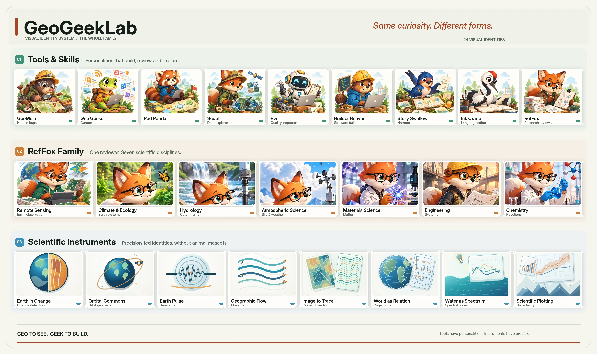

# GeoGeekLab · Visual Identity System

**One identity. Many forms.**  
*Same curiosity. Different forms.*

Meet the whole family — 24 project identities. [View the full-resolution portrait](assets/family/GeoGeekLab-family-portrait-v1.webp).

## Meet the family

### 01 · Tools & Skills — 9 personalities

[GeoMole](https://github.com/GeoGeekLab/geodebug) · [Geo Gecko](https://github.com/GeoGeekLab/awesome-tech-feeds) · [Red Panda](https://github.com/GeoGeekLab/personal-learning-map) · [Scout](https://github.com/GeoGeekLab/stac-scout) · [Evi](https://github.com/GeoGeekLab/engineering-quality) · [Builder Beaver](https://github.com/GeoGeekLab/modern-software-codex-skills) · [Story Swallow](https://github.com/GeoGeekLab/scientific-storytelling-skill) · [Ink Crane](https://github.com/GeoGeekLab/academic-terminology-zh) · [RefFox](https://github.com/GeoGeekLab/nature-reviewer-skills)

**Tools have personalities.** Each mascot represents how its project builds, discovers, teaches, evaluates, or communicates.

### 02 · RefFox Family — 7 disciplines

[Remote Sensing](https://github.com/GeoGeekLab/nature-remote-sensing-reviewer-skill) · [Climate & Ecology](https://github.com/GeoGeekLab/nature-climate-ecology-reviewer-skill) · [Hydrology](https://github.com/GeoGeekLab/nature-hydrology-reviewer-skill) · [Atmospheric Science](https://github.com/GeoGeekLab/nature-atmospheric-science-reviewer-skill) · [Materials Science](https://github.com/GeoGeekLab/nature-materials-science-reviewer-skill) · [Engineering](https://github.com/GeoGeekLab/nature-engineering-reviewer-skill) · [Chemistry](https://github.com/GeoGeekLab/nature-chemistry-reviewer-skill)

**One reviewer. Seven perspectives.** The shared RefFox character adapts to different scientific evidence and methods.

### 03 · Scientific Instruments — 8 symbols

[Earth in Change](https://github.com/GeoGeekLab/earth-in-change) · [Orbital Commons](https://github.com/GeoGeekLab/orbital-commons) · [Earth Pulse](https://github.com/GeoGeekLab/earth-pulse) · [Geographic Flow Lab](https://github.com/GeoGeekLab/geographic-flow-lab) · [Image to Trace](https://github.com/GeoGeekLab/image-to-trace) · [World as Relation](https://github.com/GeoGeekLab/world-as-relation) · [Water as Spectrum](https://github.com/GeoGeekLab/water-as-spectrum) · [Scientific Plotting](https://github.com/GeoGeekLab/ipcc-wg1-scientific-plotting-skill)

**Instruments have precision.** Geometry and scientific processes lead; animals do not appear in these identities.

## Explore the design system

| Resource | Contents |
|:--|:--|
| [Current README artwork](readme-artwork/v3/) | 20 production-facing mascot and instrument images |
| [Scientific instrument artwork](logos/scientific-instruments/readme-artwork-v2/) | Four text-free SVG scientific illustrations |
| [Family portrait](assets/family/) | Complete 24-identity visual overview and composition notes |
| [Design guidelines (中文)](GUIDE.zh-CN.md) | Mascot rules, typography, colors, and QA |
| [Identity sheets](identity-sheets/) | Project-specific design guidance |
| [README integration](README-INTEGRATION.md) | Central-to-project asset deployment |
| [Concept archive](GALLERY.md) | Early V0.2 explorations, not necessarily current artwork |

## Principles

- **Recognizable, not repetitive.** Give each tool a distinct character without forcing the same mascot everywhere.
- **One RefFox, many disciplines.** Vary the scientific task, not the character identity.
- **Scientific meaning first.** Instruments use clean visual metaphors, never invented measurement plots.
- **Text-free project artwork.** Keep explanatory copy in accessible README text, not embedded in each illustration.
- **Shared structure, independent palettes.** Use consistent delivery standards without stripping projects of their character.

The parent palette follows the existing [GeoGeekLab website](https://github.com/GeoGeekLab/GeoGeekLab.github.io): paper `#F6F4EE`, ink `#152019`, and signal `#A64624`.

## Status & provenance

**Current: V3 README visual identities.** Earlier V0.2 concept artwork remains in the repository as an archive. The 24 visual identities appear across project README pages; the GeoGeekLab personal profile and the website retain their existing presentation.

The RefFox scientific-domain images derived from a multi-panel illustration and still deserve independent high-resolution refinement. Scientific symbols are illustrative, not observed data. See [Art & Provenance](ARTWORK-NOTICE.md) and [Asset Validation](VALIDATION.md).

---

*Geo to see. Geek to build.*
