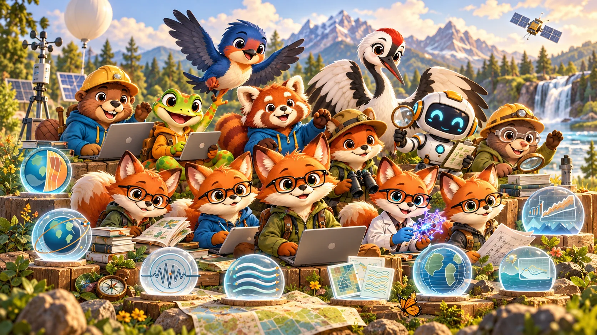

# GeoGeekLab Family · Group Photo V2

**One identity. Many forms. One shared world.**

This is an **illustrated group photo**, not a tiled catalogue. The characters stand and interact in one imagined outdoor research camp. Scientific instrument identities appear as symbolic displays and props, rather than separate animal mascots.

## Art direction

- **Format:** 1672 × 941 px (wide landscape); optimized WebP for GitHub README.
- **Composition:** foreground reviewers, background tools and skills, scientific instruments integrated into the environment.
- **Mood:** collaborative, curious, warm, recognizable, and playful without turning the instruments into characters.
- **Style:** consistent semi-3D illustration, soft natural light, coherent perspective, no panels or text embedded in the artwork.
- **Scope:** an imaginative ensemble portrait. It is **not** a literal one-to-one depiction of all 24 project artworks; the authoritative identity list is in the [root README](../../README.md).

## Original montage archive

The [V1 project-by-project overview](GeoGeekLab-family-portrait-v1.webp) remains available as a reference. It is no longer the root README cover.

## Artwork notes

The group illustration is AI-generated and edited for GitHub display. Individual mascot artwork and scientific marks remain in the project's [current README artwork](../../readme-artwork/v3/) and [scientific artwork](../../logos/scientific-instruments/readme-artwork-v2/) directories.

The illustration is a visual identity artwork, not a scientific plot, observational data source, or endorsement from any external organization.
