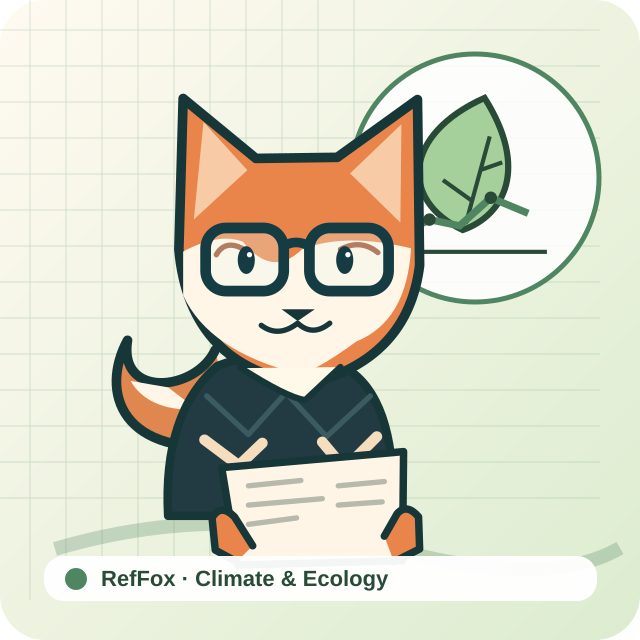
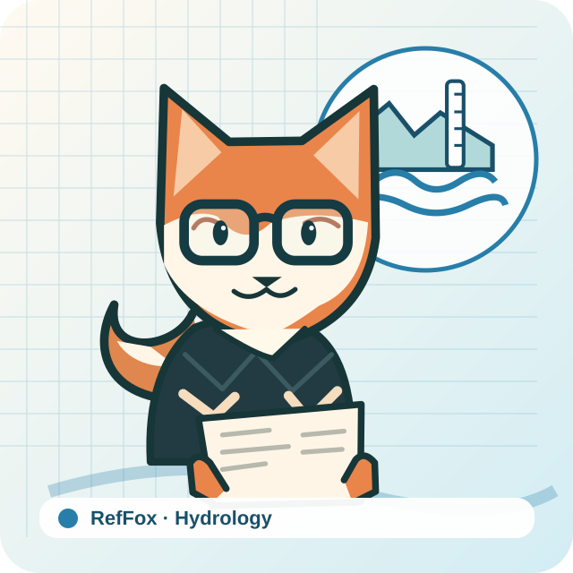
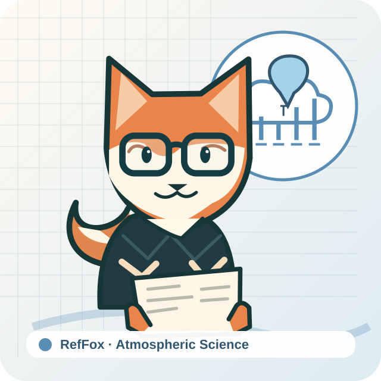

# RefFox · Seven reviewer identities

> Batch 02 · Formal design candidates · 2026-10-25

Each domain shares the same fox character and uses domain-specific evidence tools. Review consistency against the existing RefFox production master before adoption.

## Remote Sensing

[Avatar](./nature-remote-sensing-reviewer-skill/avatar.svg) · [Discipline mark](./nature-remote-sensing-reviewer-skill/discipline-mark.svg) · [README hero](./nature-remote-sensing-reviewer-skill/readme-hero.svg) · [Social preview](./nature-remote-sensing-reviewer-skill/social-preview.svg) · [Style guide](./nature-remote-sensing-reviewer-skill/STYLEGUIDE.md)

## Climate & Ecology

[Avatar](./nature-climate-ecology-reviewer-skill/avatar.svg) · [Discipline mark](./nature-climate-ecology-reviewer-skill/discipline-mark.svg) · [README hero](./nature-climate-ecology-reviewer-skill/readme-hero.svg) · [Social preview](./nature-climate-ecology-reviewer-skill/social-preview.svg) · [Style guide](./nature-climate-ecology-reviewer-skill/STYLEGUIDE.md)

## Hydrology

[Avatar](./nature-hydrology-reviewer-skill/avatar.svg) · [Discipline mark](./nature-hydrology-reviewer-skill/discipline-mark.svg) · [README hero](./nature-hydrology-reviewer-skill/readme-hero.svg) · [Social preview](./nature-hydrology-reviewer-skill/social-preview.svg) · [Style guide](./nature-hydrology-reviewer-skill/STYLEGUIDE.md)

## Atmospheric Science

[Avatar](./nature-atmospheric-science-reviewer-skill/avatar.svg) · [Discipline mark](./nature-atmospheric-science-reviewer-skill/discipline-mark.svg) · [README hero](./nature-atmospheric-science-reviewer-skill/readme-hero.svg) · [Social preview](./nature-atmospheric-science-reviewer-skill/social-preview.svg) · [Style guide](./nature-atmospheric-science-reviewer-skill/STYLEGUIDE.md)

## Materials Science

[Avatar](./nature-materials-science-reviewer-skill/avatar.svg) · [Discipline mark](./nature-materials-science-reviewer-skill/discipline-mark.svg) · [README hero](./nature-materials-science-reviewer-skill/readme-hero.svg) · [Social preview](./nature-materials-science-reviewer-skill/social-preview.svg) · [Style guide](./nature-materials-science-reviewer-skill/STYLEGUIDE.md)

## Engineering

[Avatar](./nature-engineering-reviewer-skill/avatar.svg) · [Discipline mark](./nature-engineering-reviewer-skill/discipline-mark.svg) · [README hero](./nature-engineering-reviewer-skill/readme-hero.svg) · [Social preview](./nature-engineering-reviewer-skill/social-preview.svg) · [Style guide](./nature-engineering-reviewer-skill/STYLEGUIDE.md)

## Chemistry

[Avatar](./nature-chemistry-reviewer-skill/avatar.svg) · [Discipline mark](./nature-chemistry-reviewer-skill/discipline-mark.svg) · [README hero](./nature-chemistry-reviewer-skill/readme-hero.svg) · [Social preview](./nature-chemistry-reviewer-skill/social-preview.svg) · [Style guide](./nature-chemistry-reviewer-skill/STYLEGUIDE.md)

## Release gate

- Scientific symbol correctness and domain review
- Same face, glasses and silhouette across domains
- 32/64px contrast and recognition test
- Dark and light README backgrounds
- No journal endorsement or trademark confusion

All seven original project repositories remain unchanged.
