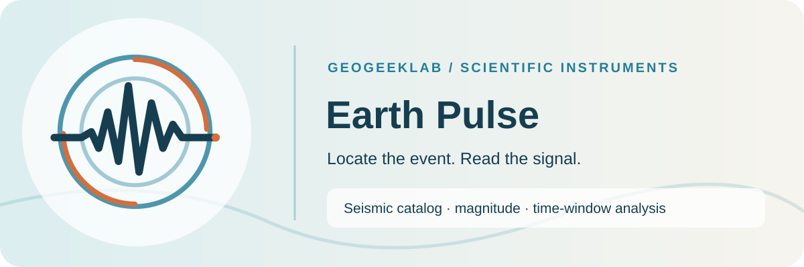
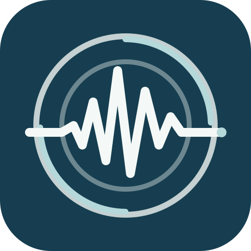
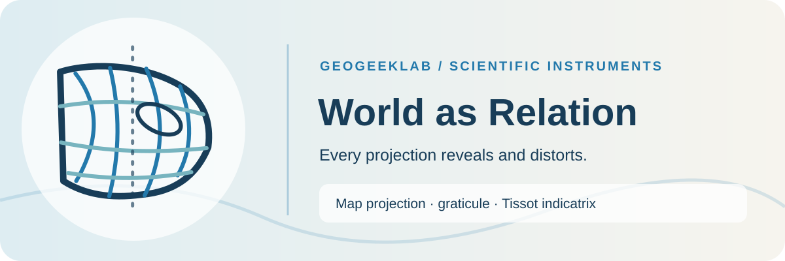
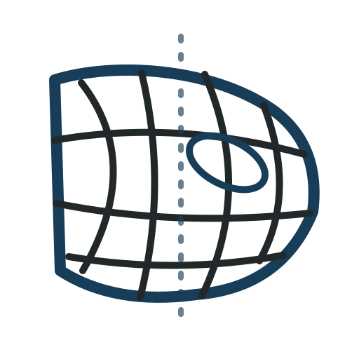
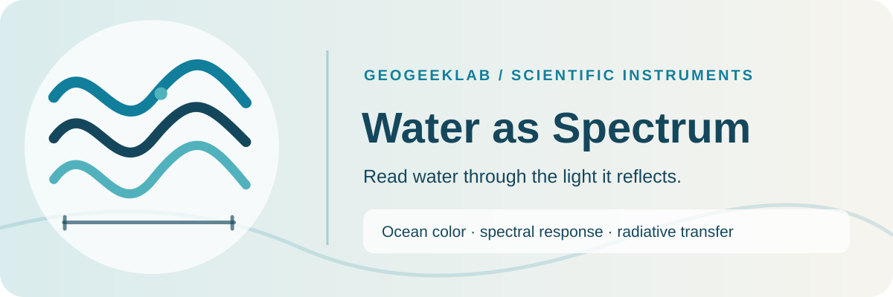
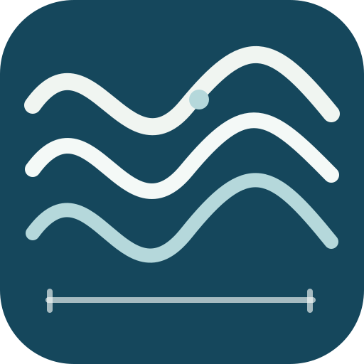
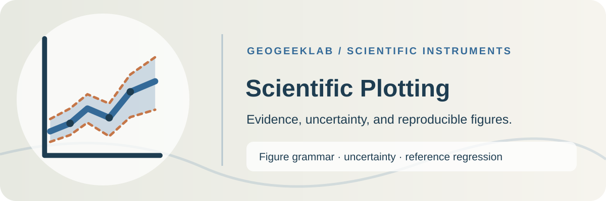
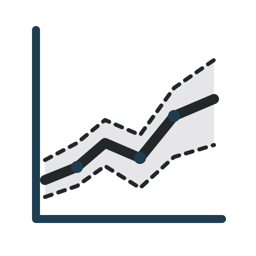
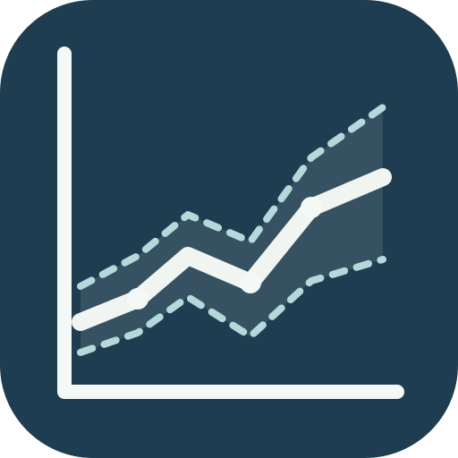

# Batch 03 · Scientific instrument gallery

7 instrument systems. All images below are SVG preview assets from this directory.

## Orbital Commons

  

[Symbol](./orbital-commons/symbol.svg) · [Favicon](./orbital-commons/favicon.svg) · [Social preview](./orbital-commons/social-preview.svg) · [Construction grid](./orbital-commons/construction.svg) · [Specifications](./orbital-commons/STYLEGUIDE.md)

**Scientific meaning:** Orbital elements · SGP4/SDP4 · observer geometry

**Caution:** Ellipses express orbital relationships symbolically; they do not encode an accurate propagated state.

## Earth Pulse

  

[Symbol](./earth-pulse/symbol.svg) · [Favicon](./earth-pulse/favicon.svg) · [Social preview](./earth-pulse/social-preview.svg) · [Construction grid](./earth-pulse/construction.svg) · [Specifications](./earth-pulse/STYLEGUIDE.md)

**Scientific meaning:** Seismic catalog · magnitude · time-window analysis

**Caution:** The waveform is a graphic metaphor, not a real seismogram or earthquake prediction.

## Geographic Flow Lab

  

[Symbol](./geographic-flow-lab/symbol.svg) · [Favicon](./geographic-flow-lab/favicon.svg) · [Social preview](./geographic-flow-lab/social-preview.svg) · [Construction grid](./geographic-flow-lab/construction.svg) · [Specifications](./geographic-flow-lab/STYLEGUIDE.md)

**Scientific meaning:** Eulerian field · OD network · trajectory · advection

**Caution:** Flow arrows are conceptual; they must not be mistaken for observed direction or measured flux.

## Image → Trace

  

[Symbol](./image-to-trace/symbol.svg) · [Favicon](./image-to-trace/favicon.svg) · [Social preview](./image-to-trace/social-preview.svg) · [Construction grid](./image-to-trace/construction.svg) · [Specifications](./image-to-trace/STYLEGUIDE.md)

**Scientific meaning:** Raster sampling · level sets · Marching Squares

**Caution:** The curved contour is schematic rather than a traced result from source imagery.

## World as Relation

  

[Symbol](./world-as-relation/symbol.svg) · [Favicon](./world-as-relation/favicon.svg) · [Social preview](./world-as-relation/social-preview.svg) · [Construction grid](./world-as-relation/construction.svg) · [Specifications](./world-as-relation/STYLEGUIDE.md)

**Scientific meaning:** Map projection · graticule · Tissot indicatrix

**Caution:** The graticule depicts symbolic distortion and is not an identified cartographic projection.

## Water as Spectrum

  

[Symbol](./water-as-spectrum/symbol.svg) · [Favicon](./water-as-spectrum/favicon.svg) · [Social preview](./water-as-spectrum/social-preview.svg) · [Construction grid](./water-as-spectrum/construction.svg) · [Specifications](./water-as-spectrum/STYLEGUIDE.md)

**Scientific meaning:** Ocean color · spectral response · radiative transfer

**Caution:** Curves represent spectral structure; the artwork is not a calibrated Rrs measurement.

## Scientific Plotting

  

[Symbol](./ipcc-wg1-scientific-plotting-skill/symbol.svg) · [Favicon](./ipcc-wg1-scientific-plotting-skill/favicon.svg) · [Social preview](./ipcc-wg1-scientific-plotting-skill/social-preview.svg) · [Construction grid](./ipcc-wg1-scientific-plotting-skill/construction.svg) · [Specifications](./ipcc-wg1-scientific-plotting-skill/STYLEGUIDE.md)

**Scientific meaning:** Figure grammar · uncertainty · reference regression

**Caution:** The band is illustrative, not climate data. This independent tool is not endorsed by IPCC.

