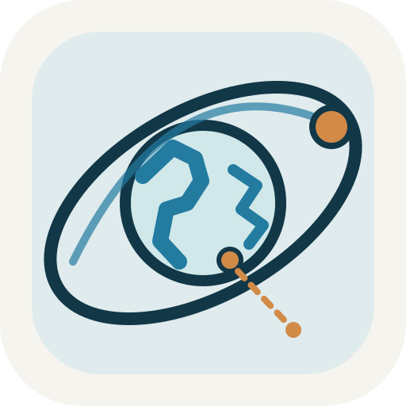
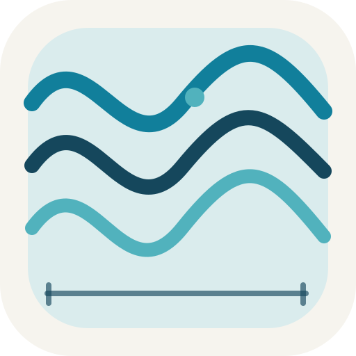
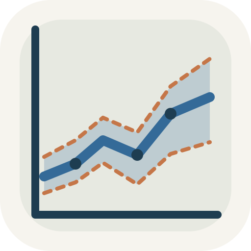

# GeoGeekLab · Scientific Instrument Logo Systems (Batch 03)

> 7 systems · 56 editable SVG files · 7 style guides · 7 token files. Status: **formal design candidates**. Existing product repositories remain unchanged.

Each mark represents a real project method rather than an animal. All assets use shared geometric discipline with project-specific meaning.

| Project | Primary | Mono | Dark | README banner | Source |
|---|---|---|---|---|---|
| Orbital Commons |  | [Mono](./orbital-commons/monochrome.svg) | [Inverse](./orbital-commons/inverse.svg) | [Hero](./orbital-commons/readme-hero.svg) | [Specification](./orbital-commons/STYLEGUIDE.md) |
| Earth Pulse |  | [Mono](./earth-pulse/monochrome.svg) | [Inverse](./earth-pulse/inverse.svg) | [Hero](./earth-pulse/readme-hero.svg) | [Specification](./earth-pulse/STYLEGUIDE.md) |
| Geographic Flow Lab |  | [Mono](./geographic-flow-lab/monochrome.svg) | [Inverse](./geographic-flow-lab/inverse.svg) | [Hero](./geographic-flow-lab/readme-hero.svg) | [Specification](./geographic-flow-lab/STYLEGUIDE.md) |
| Image → Trace |  | [Mono](./image-to-trace/monochrome.svg) | [Inverse](./image-to-trace/inverse.svg) | [Hero](./image-to-trace/readme-hero.svg) | [Specification](./image-to-trace/STYLEGUIDE.md) |
| World as Relation |  | [Mono](./world-as-relation/monochrome.svg) | [Inverse](./world-as-relation/inverse.svg) | [Hero](./world-as-relation/readme-hero.svg) | [Specification](./world-as-relation/STYLEGUIDE.md) |
| Water as Spectrum |  | [Mono](./water-as-spectrum/monochrome.svg) | [Inverse](./water-as-spectrum/inverse.svg) | [Hero](./water-as-spectrum/readme-hero.svg) | [Specification](./water-as-spectrum/STYLEGUIDE.md) |
| Scientific Plotting |  | [Mono](./ipcc-wg1-scientific-plotting-skill/monochrome.svg) | [Inverse](./ipcc-wg1-scientific-plotting-skill/inverse.svg) | [Hero](./ipcc-wg1-scientific-plotting-skill/readme-hero.svg) | [Specification](./ipcc-wg1-scientific-plotting-skill/STYLEGUIDE.md) |

## Scientific guardrails

- Orbital diagrams are conceptual rather than numerical propagation outputs.
- Waveforms, flow arrows, spectral curves and uncertainty bands are illustrative, not observed values.
- No IPCC branding or endorsement is implied for the independently developed plotting tool.
- SVG source files remain editable; no fonts, raster textures or external image dependencies are embedded.
- Review the candidate before inserting it into the corresponding scientific instrument repository.
