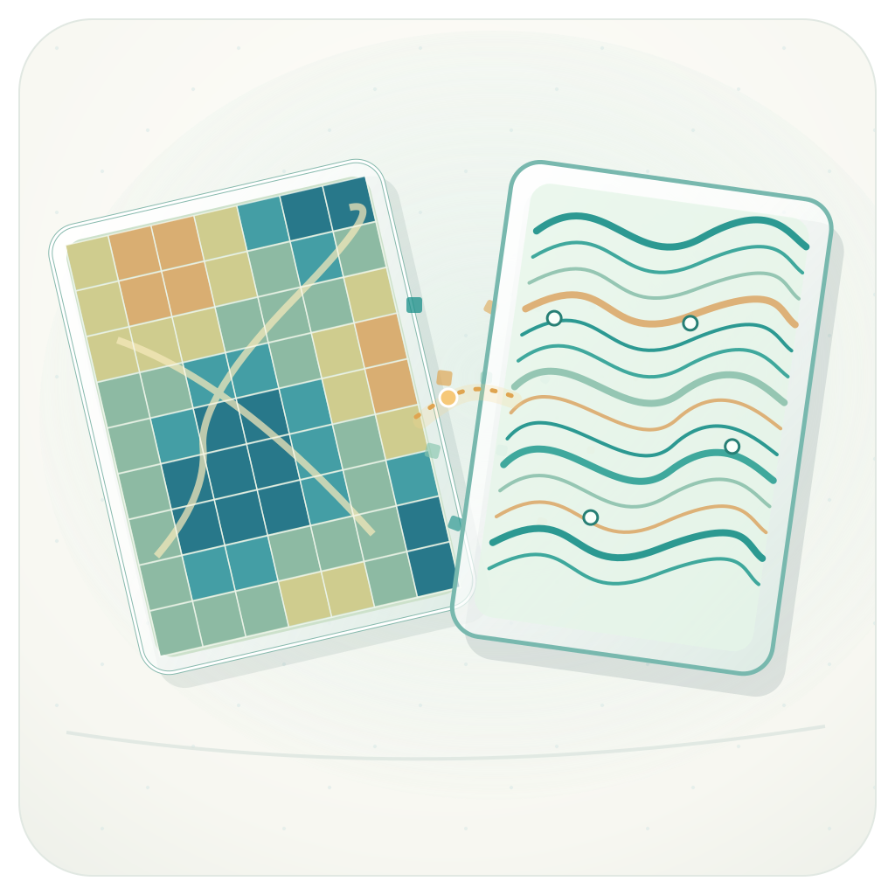
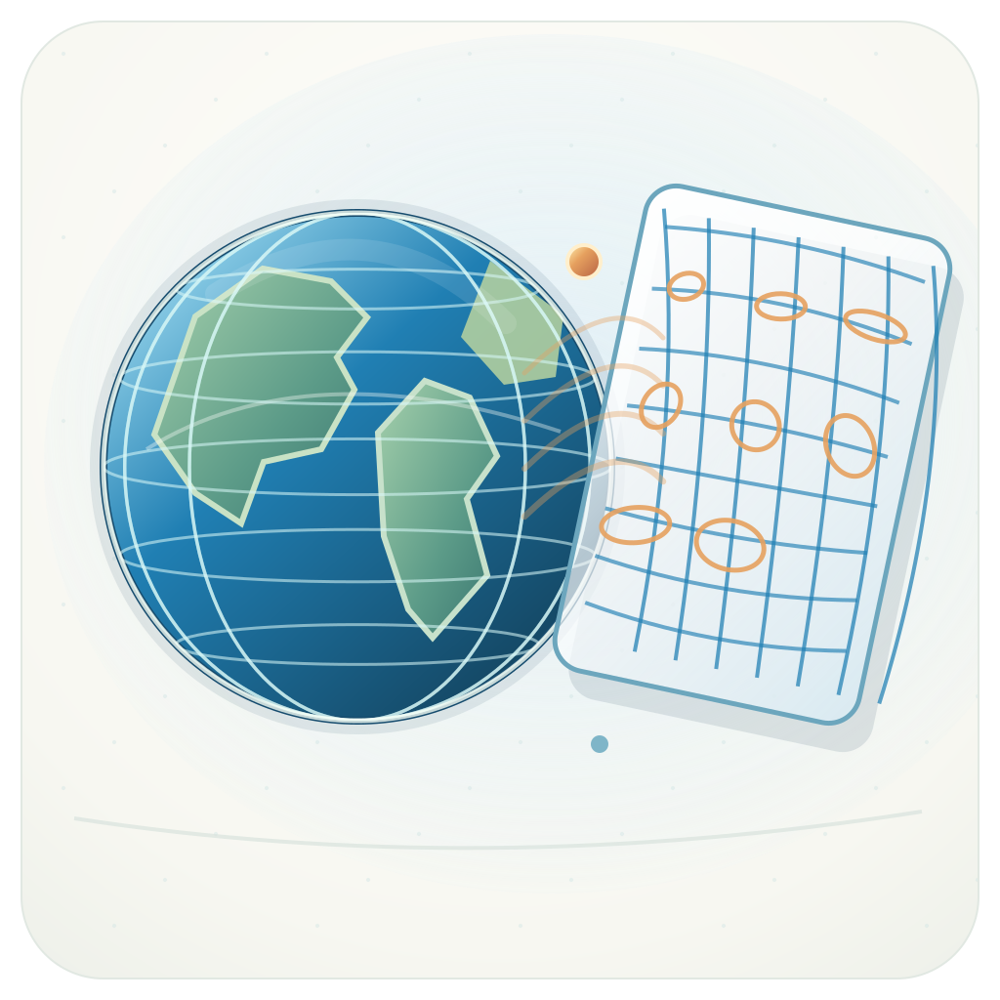
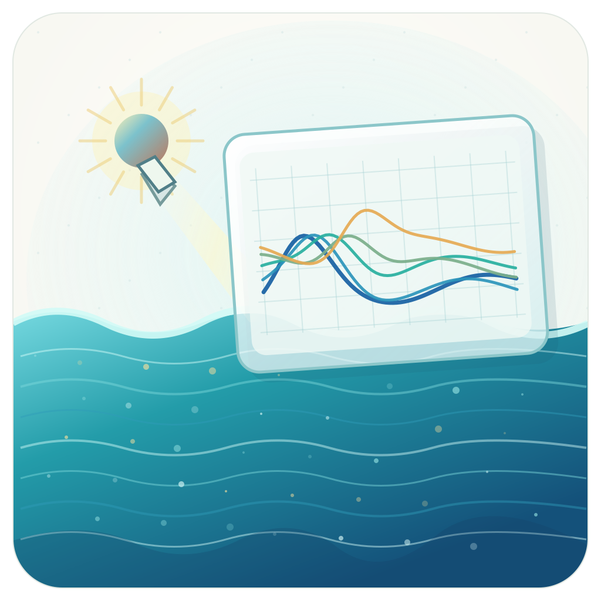
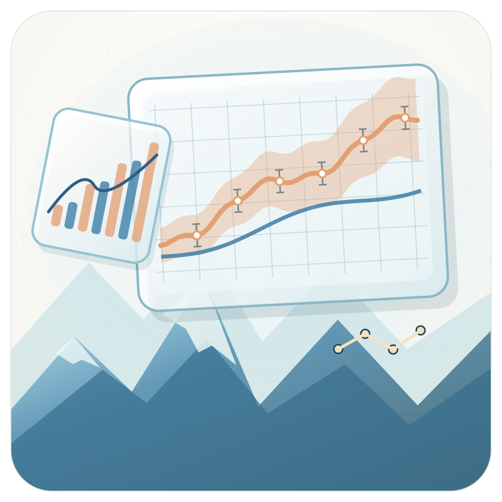

# Scientific Instrument README Artwork · Release V2

Four text-free, mascot-free, project-specific SVG artworks. The scientific patterns are illustrative, not observations. This release replaces prior typography-heavy README banners in their four project repositories.

## image-to-trace

[Project README](https://github.com/GeoGeekLab/image-to-trace#readme) · [Vector source](./image-to-trace/readme-artwork.svg)

## world-as-relation

[Project README](https://github.com/GeoGeekLab/world-as-relation#readme) · [Vector source](./world-as-relation/readme-artwork.svg)

## water-as-spectrum

[Project README](https://github.com/GeoGeekLab/water-as-spectrum#readme) · [Vector source](./water-as-spectrum/readme-artwork.svg)

## ipcc-wg1-scientific-plotting-skill

[Project README](https://github.com/GeoGeekLab/ipcc-wg1-scientific-plotting-skill#readme) · [Vector source](./ipcc-wg1-scientific-plotting-skill/readme-artwork.svg)

## Release checks

- No visible text, branding overlay or animal imagery
- 1024 × 1024 square vector canvas
- No external images, scripts or remote fonts
- Retain each instrument's original screenshot and scientific description
- IPCC scientific plotting illustration is an independent GeoGeekLab visual and does not imply endorsement
