# README artwork · V3

20 independent, **text-free** hero illustrations for GeoGeekLab repositories. Mascot projects use character-centered artwork; scientific instruments use non-animal marks. All files are optimized WebP, 768px maximum. Project README integration replaces legacy branded banners while preserving core technical documentation.

| Project | Artwork | Project README |
|---|---|---|
| `modern-software-codex-skills` |  | [README](https://github.com/GeoGeekLab/modern-software-codex-skills#readme) |
| `scientific-storytelling-skill` | 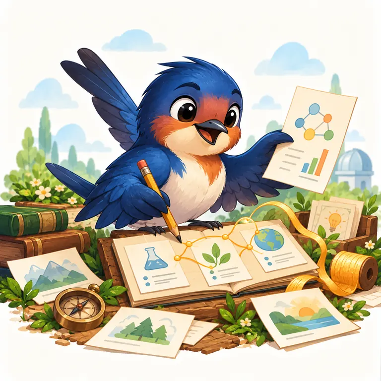 | [README](https://github.com/GeoGeekLab/scientific-storytelling-skill#readme) |
| `academic-terminology-zh` |  | [README](https://github.com/GeoGeekLab/academic-terminology-zh#readme) |
| `geodebug` | 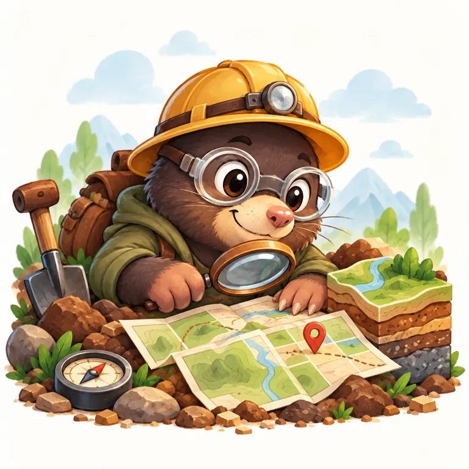 | [README](https://github.com/GeoGeekLab/geodebug#readme) |
| `awesome-tech-feeds` |  | [README](https://github.com/GeoGeekLab/awesome-tech-feeds#readme) |
| `personal-learning-map` |  | [README](https://github.com/GeoGeekLab/personal-learning-map#readme) |
| `stac-scout` | 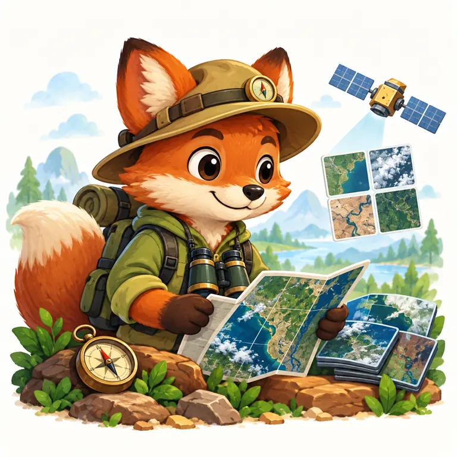 | [README](https://github.com/GeoGeekLab/stac-scout#readme) |
| `engineering-quality` |  | [README](https://github.com/GeoGeekLab/engineering-quality#readme) |
| `nature-reviewer-skills` |  | [README](https://github.com/GeoGeekLab/nature-reviewer-skills#readme) |
| `nature-remote-sensing-reviewer-skill` | 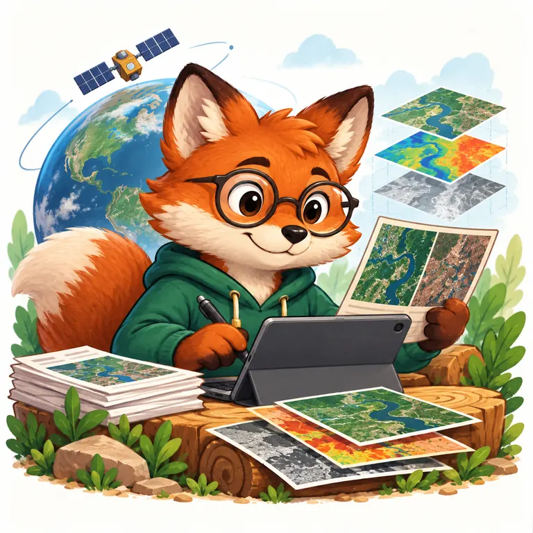 | [README](https://github.com/GeoGeekLab/nature-remote-sensing-reviewer-skill#readme) |
| `nature-climate-ecology-reviewer-skill` | 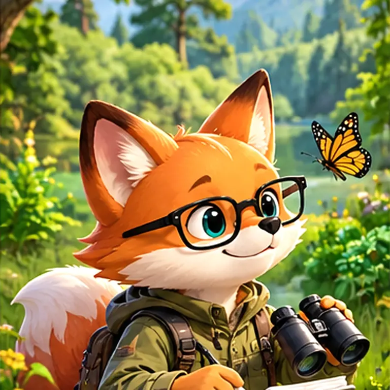 | [README](https://github.com/GeoGeekLab/nature-climate-ecology-reviewer-skill#readme) |
| `nature-hydrology-reviewer-skill` | 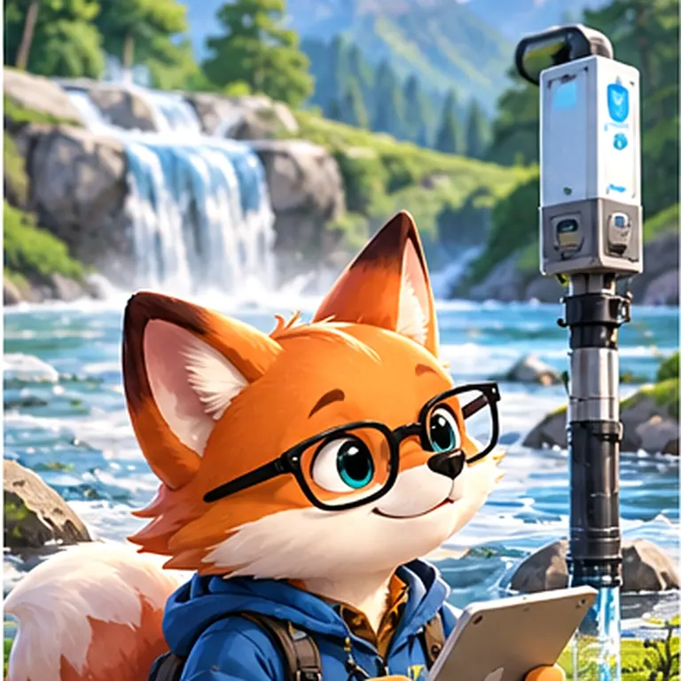 | [README](https://github.com/GeoGeekLab/nature-hydrology-reviewer-skill#readme) |
| `nature-atmospheric-science-reviewer-skill` | 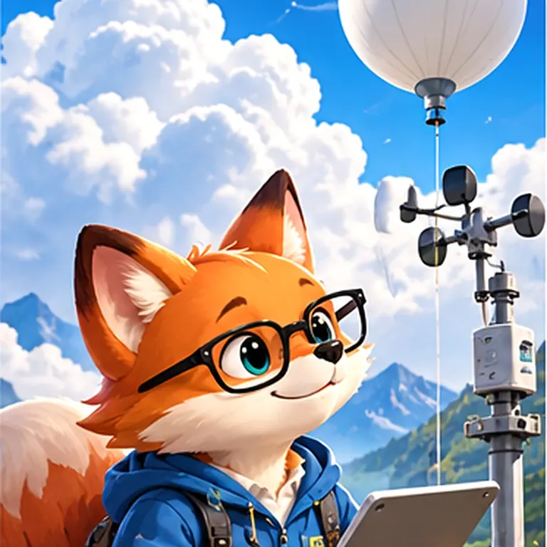 | [README](https://github.com/GeoGeekLab/nature-atmospheric-science-reviewer-skill#readme) |
| `nature-materials-science-reviewer-skill` | 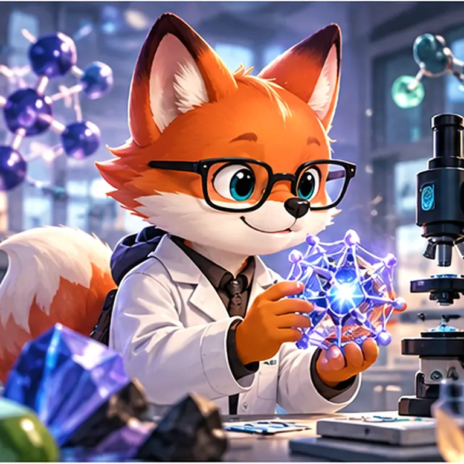 | [README](https://github.com/GeoGeekLab/nature-materials-science-reviewer-skill#readme) |
| `nature-engineering-reviewer-skill` | 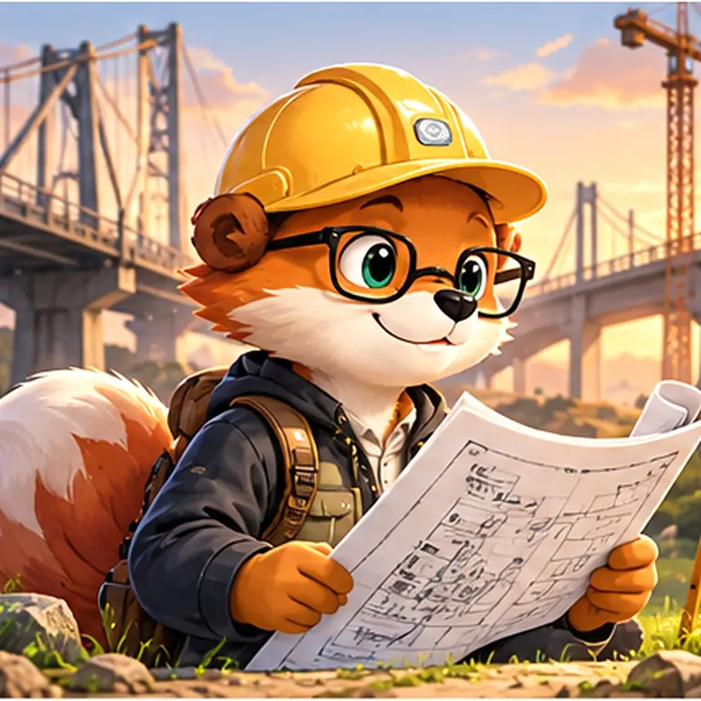 | [README](https://github.com/GeoGeekLab/nature-engineering-reviewer-skill#readme) |
| `nature-chemistry-reviewer-skill` |  | [README](https://github.com/GeoGeekLab/nature-chemistry-reviewer-skill#readme) |
| `earth-in-change` | 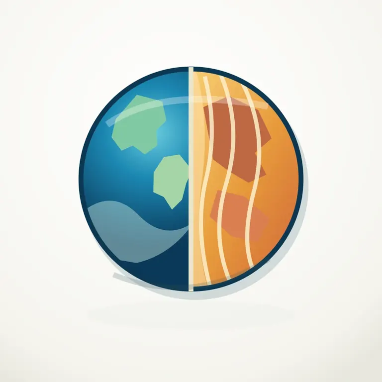 | [README](https://github.com/GeoGeekLab/earth-in-change#readme) |
| `orbital-commons` |  | [README](https://github.com/GeoGeekLab/orbital-commons#readme) |
| `earth-pulse` | 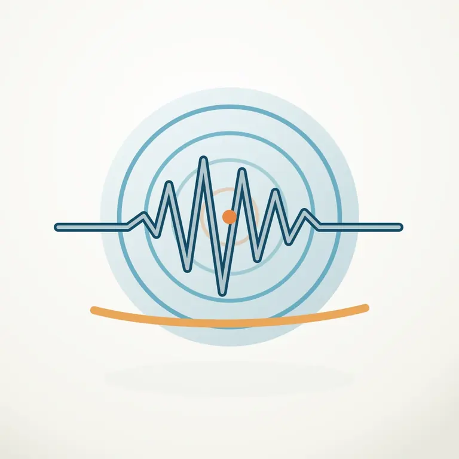 | [README](https://github.com/GeoGeekLab/earth-pulse#readme) |
| `geographic-flow-lab` | 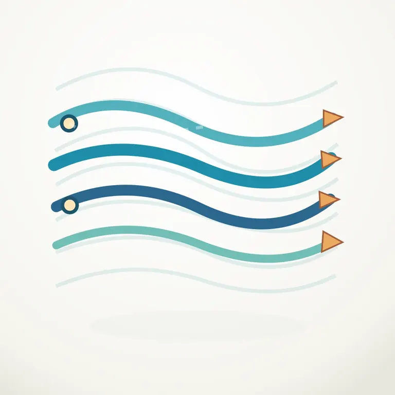 | [README](https://github.com/GeoGeekLab/geographic-flow-lab#readme) |

## Rules

- Keep artwork itself free of captions, headlines and typography.
- Use a separate `` description for accessibility.
- Never turn scientific instruments into animal mascots.
- Images depict concepts, not scientific measurements.
- Do not imply endorsement by Nature Portfolio, IPCC or other journals or organizations.
